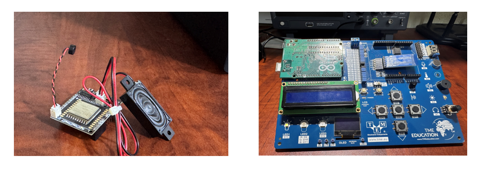
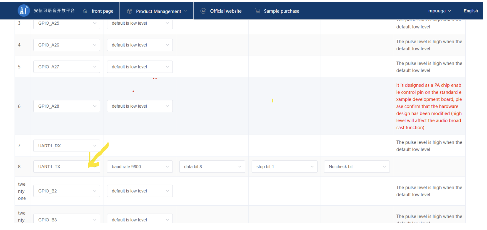
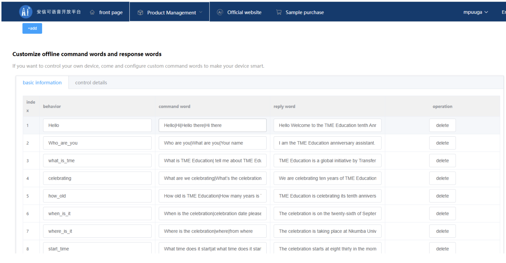
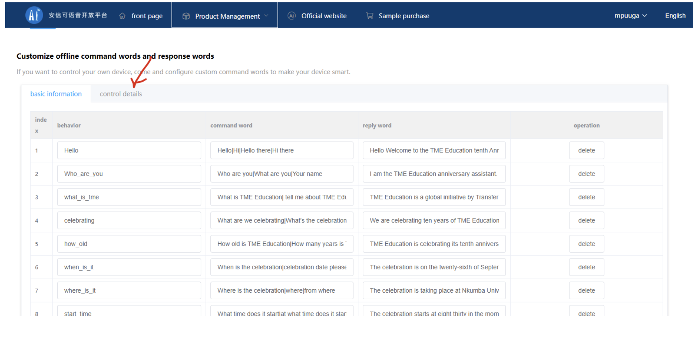
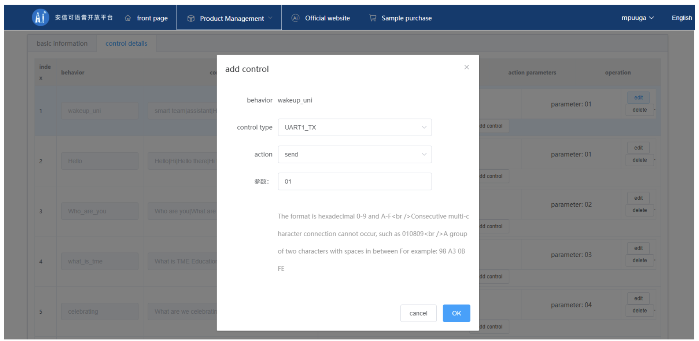
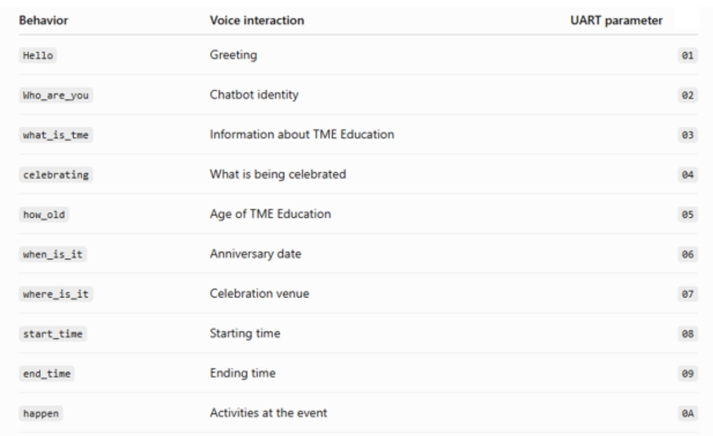

# TME Education 10th Anniversary Voice-Interactive Chatbot

This project presents the design and implementation of an offline voice-interactive chatbot developed for the TME Education 10th Anniversary celebration. The system uses an Arduino Uno as the main controller and a VC-02 offline voice-recognition module to recognize predefined spoken questions and provide corresponding voice responses without requiring an internet connection. Users can interact with the chatbot to obtain information about TME Education and its 10th anniversary celebration.

To enhance user interaction, an SH1106 OLED display presents animated chatbot expressions, including blinking, eye movements, happy and excited faces, and celebration animations. A 16x2 LCD continuously displays the anniversary message, while NeoPixel LEDs provide dynamic, colorful lighting. The project demonstrates how embedded systems, offline voice recognition, displays, and interactive visual effects can be integrated into an engaging educational human-machine interaction system.

## Project video

[Watch the TME Education 10th Anniversary Voice-Interactive Chatbot demonstration on YouTube](https://youtu.be/8j01JvC5oN0?si=cfuaJ4DatR63d894)


## Development process

### 1. Define the chatbot requirements

The first step was to determine what the system should do. The chatbot was designed to:

- Recognize predefined questions about TME Education and the 10th anniversary celebration.
- Provide spoken responses.
- Display expressive animations.
- Show an anniversary message.
- Provide colorful lighting effects.

### 2. Prepare the TME-EDU-ARD-2 board

The TME Education Board was selected as the main development platform. Its integrated Arduino Uno-based controller, OLED display, 16x2 LCD, and addressable NeoPixel LEDs provide the chatbot's control and visual functions.



### 3. Configure the VC-02 offline voice module

The VC-02 was configured through the [Ai-Thinker Voice Open Platform](https://voice.ai-thinker.com/) to perform offline speech recognition, generate predefined voice responses, and transmit command bytes to the TME Education Board. Configuration was completed in three main stages.

#### UART pin selection and configuration

The UART interface enables communication between the VC-02 and the TME Education Board. In the pin configuration page:

- `GPIO_B7` was assigned as `UART1_TX`.
- `GPIO_B6` was assigned as `UART1_RX`.
- Baud rate: `9600`.
- Data bits: `8`.
- Stop bits: `1`.
- Parity: no check bit.



`UART1_TX` is the important signal for this project because the VC-02 sends a command to the Arduino whenever a recognized offline command is triggered.

The physical communication connections are:

```text
VC-02 UART1_TX -> TME Education Board / Arduino RX (D2)
VC-02 GND      -> TME Education Board GND
```

The Arduino receives the VC-02 data on D2 through the `SoftwareSerial` library. A common ground must be connected between the VC-02 and the TME Education Board.

#### Customized offline command configuration

The next stage is completed under **Customize offline command words and response words**. Select **Add** to create a custom offline command. Each chatbot interaction contains three important fields:

- **Behavior:** the internal identifier for the interaction, such as `Hello` or `Who_are_you`.
- **Command word:** one or more phrases that the user can say to trigger the behavior.
- **Reply word:** the response spoken by the VC-02 after the command is recognized.



#### Control details configuration

After creating an offline command, open the **Control details** section to define the data that the VC-02 transmits when the behavior is activated.



For each command, configure:

- **Control type:** `UART1_TX`.
- **Action:** `Send`.
- **Parameter:** the unique hexadecimal value assigned to the behavior.

For example, the `Hello` behavior uses parameter `01`.



The parameter field uses hexadecimal data. Therefore, `01` represents the byte value `0x01`; it must not be treated as the ASCII characters `0` and `1`.

#### Assign unique UART commands

A unique hexadecimal value is assigned to every chatbot behavior so the Arduino can determine which question was recognized.

| Behavior | Voice interaction | UART parameter |
|---|---|---:|
| `Hello` | Greeting | `01` |
| `Who_are_you` | Chatbot identity | `02` |
| `what_is_tme` | Information about TME Education | `03` |
| `celebrating` | What is being celebrated | `04` |
| `how_old` | Age of TME Education | `05` |
| `when_is_it` | Anniversary date | `06` |
| `where_is_it` | Celebration venue | `07` |
| `start_time` | Starting time | `08` |
| `end_time` | Ending time | `09` |
| `happen` | Activities at the event | `0A` |



For more guidance on configuring the Ai-Thinker offline voice module, watch this [VC-02 configuration tutorial](https://www.youtube.com/watch?v=dAqX4CmozfM&t=6s).

### 4. Develop the OLED chatbot animations

Different animations were programmed for the board's OLED display to give the chatbot a visual personality. They include:

- Normal eyes.
- Blinking and double blinking.
- Looking left and right.
- Happy and excited expressions.
- Anniversary animations.
- Dancing characters.
- Celebration effects.

Different animations are associated with different voice commands.

### 5. Configure the 16x2 LCD

The board's LCD continuously displays a simple anniversary message without scrolling:

```text
HAPPY 10TH
TME EDUCATION
```

This provides a permanent visual indication of the project's purpose while the OLED performs the interactive chatbot animations.

### 6. Program the NeoPixel lighting

The integrated addressable NeoPixel LEDs remain illuminated and continuously cycle through different colors. The changing colors create a more attractive celebration effect and make the chatbot visually engaging during demonstrations.

### 7. Integrate voice commands with animations

A command-processing function was developed on the Arduino. When a hexadecimal command is received from the VC-02, the program identifies the command and runs the corresponding OLED animation. For example, asking about the age of TME Education triggers the 10-year celebration animation, while the celebration command activates the dancing and anniversary sequence.

## Source code and libraries

The [final Arduino code](final_code/final_code.ino) contains custom Arduino libraries for the TME-EDU-ARD-2. Import the required libraries before uploading the program to the Arduino Uno.

## Repository contents

```text
Voice-Interactive Chatbot/
|-- final_code/
|   `-- final_code.ino
|-- Images/
|-- report.docx
`-- README.md
```
